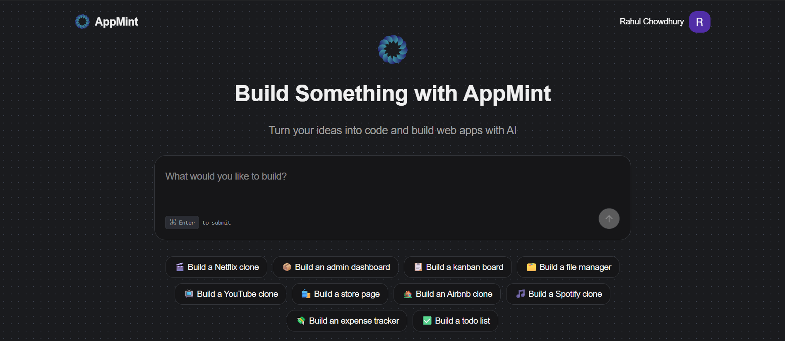

# AppMint

Live: https://app-mint-phi.vercel.app/
GitHub: https://github.com/rahulchy960/AppMint

## Overview
AppMint is a generative SaaS app builder. Users describe an app, AppMint runs an Inngest-powered agent in an E2B sandbox with the OpenAI API, and the app returns a live preview plus the generated code.

## Screenshots
| Home | Code Explorer | Live Preview |
| --- | --- | --- |
|  |  |  |


## Key features
- Typed APIs via tRPC with React Query and SuperJSON.
- Clerk auth for sign-in, sign-up, and user sessions.
- Prisma + PostgreSQL data layer with migrations.
- Event-driven generation pipeline (Inngest + Agent Kit + OpenAI API).
- Live sandbox preview with refresh, copy URL, and open-in-new-tab.
- File explorer with tree navigation and syntax-highlighted code view.
- Credit-based usage tracking and rate limiting with RateLimiterPrisma.

## Tech stack
- Next.js 15 (App Router), React 19, TypeScript
- tRPC, React Query, SuperJSON
- Prisma, PostgreSQL (Neon)
- Clerk, Inngest, E2B, OpenAI API
- Tailwind CSS v4, shadcn/ui, Tweakcn UI

## Architecture & Execution Flow
1. User submits an app idea (home or project thread).
2. tRPC stores the user message and emits `code-agent/run`.
3. Inngest initializes or connects to an E2B sandbox.
4. The AI agent generates files inside the sandbox.
5. Output is saved as a `Fragment` (files + sandbox URL).
6. UI polls for updates and renders:
   - Live Preview
   - Generated Code

## AI Agent Function (Inngest + Agent Kit)

AppMint uses an **event-driven Inngest function (`code-agent`)** to power the core app-generation workflow in a scalable and non-blocking way.

- The agent is triggered by the `code-agent/run` event and executes entirely outside the request–response lifecycle.
- For each run, a **dedicated E2B sandbox** is created with an extended timeout, ensuring safe and isolated execution of AI-generated code.
- The agent bootstraps context by loading the **latest project messages** from the database and injecting them into the agent’s memory.
- A **stateful coding agent** is created using Inngest Agent Kit, maintaining:
  - A task summary (`summary`) that signals completion
  - A file map (`files`) containing all generated or updated source files
- The agent is equipped with sandbox-aware tools that allow it to:
  - Run terminal commands inside the sandbox
  - Create and update files programmatically
  - Read existing files for iterative refinement
- Generation runs in a **controlled iteration loop**, terminating only after a structured task summary is produced.
- After completion:
  - A lightweight agent generates a **concise fragment title**
  - Another agent generates the **final assistant response** shown to the user
- A **live preview URL** is exposed from the sandbox, enabling instant application previews.
- Results are persisted atomically:
  - On success, generated files and preview metadata are stored as a `Fragment`
  - On failure, a structured error message is recorded in the project thread

This architecture ensures **safe execution, reproducibility, and horizontal scalability**, while remaining **model-agnostic** and ready to benefit from stronger LLMs as they become available.


## Data model (Prisma)
- Project: user-owned workspace.
- Message: chat entries with role (USER/ASSISTANT) and type (RESULT/ERROR).
- Fragment: sandbox URL, title, and a JSON map of generated files.
- Usage: rate limiter store for credit tracking (points and expiry per user).

## Credits and abuse protection
- Each user starts with 10 credits per 7-day window; each generation consumes 1 credit.
- Implemented with `rate-limiter-flexible` using RateLimiterPrisma for atomic, concurrent-safe consumption.
- Postgres-backed storage keeps limits consistent across instances.
- `msBeforeNext` supports precise reset timing in the UI.

## Routes
- `/`: home page, project creation, project list.
- `/projects/[projectId]`: chat view + preview + code explorer.
- `/sign-in`, `/sign-up`: Clerk auth pages.
- `/api/trpc`: tRPC endpoint.
- `/api/inngest`: Inngest function handler.

## Project layout
- `src/app`: Next.js routes, layouts, API handlers.
- `src/modules`: feature modules (home, projects, messages, usage).
- `src/components`: shared UI widgets (file explorer, tree view, code view).
- `src/inngest`: Inngest client and function.
- `prisma`: schema and migrations.
- `sandbox-templates/nextjs`: E2B sandbox template build.

## Project structure (overview)
```
.
|-- src/
|   |-- app/
|   |   |-- (home)/
|   |   |-- api/
|   |   |   |-- inngest/route.ts
|   |   |   +-- trpc/[trpc]/route.ts
|   |   +-- projects/[projectId]/page.tsx
|   |-- components/
|   |-- hooks/
|   |-- inngest/
|   |-- lib/
|   |-- modules/
|   +-- trpc/
|-- prisma/
|   |-- schema.prisma
|   +-- migrations/
|-- public/
|-- sandbox-templates/nextjs/
+-- README.md
```

## Backend setup
- tRPC lives in `src/trpc` with routers composed in `src/trpc/routers/_app.ts`.
- API handlers are in `src/app/api/trpc/[trpc]/route.ts` and `src/app/api/inngest/route.ts`.
- Prisma client is created in `src/lib/db.ts` and generated to `src/generated/prisma`.
- Inngest function pipeline is in `src/inngest/functions.ts` and uses E2B sandboxes.
- Auth is enforced by Clerk middleware in `src/middleware.ts`.


## Database relation idea
Current relations in `prisma/schema.prisma`:
- `Project` (user-owned workspace) 1 -> many `Message`.
- `Message` 0/1 -> 1 `Fragment` (unique `messageId`).
- `Usage` keyed by `userId` for rate limiting.


## Limitations

- **Generation quality is entirely dependent on the underlying LLM**
  - AppMint itself does not hardcode logic or templates for app generation.
  - The AI agent’s output quality directly reflects the reasoning and coding capabilities of the model used.

- **Current model support**
  - Inngest currently supports models up to **GPT-4.5**, which is used by the agent.
  - As a result, code quality, architectural decisions, and completeness are constrained by GPT-4.5’s capabilities.

- **Future improvement path**
  - If Inngest adds support for more advanced models such as **GPT-5.2** or **GPT-Codex-Max**,  
    the same pipeline will automatically benefit from:
    - Better architectural decisions
    - Higher code correctness
    - Improved multi-file reasoning
    - More production-ready outputs  

In short, **AppMint’s core value lies in its architecture** — stronger models will directly translate into significantly better results without major system changes.
